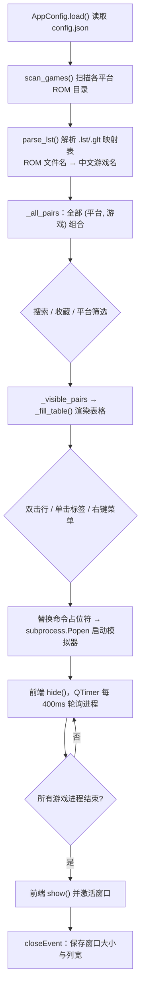

# Oneline

## 一、项目概述

Oneline 是一个用 **Python 3.14 + PyQt5** 开发的桌面游戏前端，把多个平台（FC、SFC、PS1 等）的 ROM 汇总到一张统一列表中：按平台配置 ROM 目录与模拟器，可选加载 `.lst` / `.glt` 映射表把 ROM 文件名替换为中文游戏名，支持实时搜索、收藏、平台多选筛选；单击模拟器标签或双击行即可用指定模拟器启动游戏，启动后前端自动隐藏，模拟器退出后自动恢复。窗口尺寸、列宽、平台配置与收藏记录都写回 `config.json`。界面使用 Qt 默认主题，图标资源（默认平台图标 + 多尺寸 exe 图标）放在 `resources/`；高分屏下按物理分辨率自动放大字体与行高。


## 二、工作原理

**目录约定**

按打包产物实现，各路径约定如下：

| 路径 | 用途 |
| --- | --- |
| `<产物目录>/Oneline.exe` | 无控制台窗口的可执行文件，双击启动 |
| `<产物目录>/config.json` | 用户配置：平台、模拟器、窗口大小、列宽、收藏都写在这里；首次运行时自动生成 |
| `<产物目录>/lib/` | PyInstaller 解包目录：PyQt5、charset_normalizer、Python 运行时与 DLL，运行时只读 |
| `<产物目录>/lib/resources/` | 随包打入的图标资源：`app.ico`（程序图标）、`default_icon.png`（默认平台图标） |

配置写在 exe 同目录而不是 `lib/` 内，这样更新程序时用户配置不会丢失；`lib/` 每次启动都会重新解包，不要把个人文件放进去。源码运行时则读取 `main.py` 同目录的 `config.json`，环境变量 `EMUFRONT_CONFIG` 可临时把配置指向其他路径，便于调试。


**处理流程**

整体是一条「读配置 → 扫描 ROM → 名称映射 → 过滤 → 渲染表格 → 启动模拟器 → 隐藏 → 轮询 → 恢复」的流水线：



**关键机制**

1. **ROM 扫描**：`scan_games()` 按文件名排序遍历平台的 `roms_dir`，跳过隐藏文件；未配置映射时显示去后缀的文件名。
2. **映射表解析**：`.lst` / `.glt` 每行以 Tab 分列，**只取前两列**（ROM 名、显示名），`//` 开头的注释行和空行忽略；匹配时去路径/后缀并转小写，未匹配到则显示原文件名。
3. **编码识别**：优先级为 UTF-8 BOM → 严格 UTF-8 → 文件头 `// codepage=N` 提示 → 候选编码（GB18030 / Big5 / Shift-JIS / CP1252 / Latin-1）按中文字符打分选优 → `charset_normalizer` 兜底；勾选「仅显示列表中匹配的 ROM」时，未映射的 ROM 不进列表。
4. **扫描缓存**：每个平台按 `(roms_dir, lst_file, mtime, size)` 生成签名，签名不变则复用扫描结果；点「刷新」或设置变更后清空缓存全量重扫。
5. **过滤与防抖**：搜索框用单次定时器防抖，避免大量 ROM 时每次按键都重建表格；收藏筛选与平台筛选互斥，平台筛选可多选并按同名分组去重。
6. **表格渲染**：三列为「游戏名称 / 平台 / 模拟器」，图标并入名称列、收藏项名称标红；模拟器列用 `EmulatorTagsDelegate`（`QStyledItemDelegate`）**自绘**彩色药丸标签而非 `cellWidget`，避免上千行时创建大量 QWidget；标签颜色由模拟器名的 FNV-1a 哈希从 10 色色板（含粉色）中取色，同一行撞色时顺延，避免整列都是蓝色；整表只读、选中整行、无焦点框，列宽可拖动并持久化。
7. **启动命令**：模板占位符为 `{emulator}`、`{rom}`、`{romname}`、`{romstem}`、`{romdir}`，默认 `"{emulator}" "{rom}"`；相对路径以程序目录 `APP_DIR` 为基准转绝对路径，模拟器进程的 `cwd` 设为模拟器所在目录，ROM 相对路径相应转换；`shell=False` 启动，500ms 内忽略重复启动请求。
8. **进程监控**：启动后隐藏窗口，400ms 定时轮询 `poll()`，全部进程结束后恢复窗口；右键菜单在多模拟器时展开子菜单，并可添加/移除收藏（收藏状态即时标红并保存）。
9. **高分屏适配**：`enable_high_dpi()` 必须在 `QApplication` 创建前调用；`get_scale()` 根据屏幕物理宽度与设备像素比给出舒适系数（4K 约 1.30、2K 约 1.15、1080P 为 1.0），用于字体、图标、行高和最小窗口尺寸。
10. **持久化时机**：关闭窗口保存窗口大小与列宽，切换收藏立即保存，导入设置变更后保存平台配置；配置不存在时自动生成默认配置。


**状态栏口径**

状态栏文案由 `_apply_filter()` 统一计算，含义如下：

| 显示 | 含义 |
| --- | --- |
| `共 N 个游戏` | 无搜索/筛选时，`_all_pairs` 的总数；N 为 0 时显示「未找到 ROM，请检查 ROMS 目录或点击刷新」 |
| `显示 N / M` | 有搜索关键词、收藏筛选或平台筛选时，N 为 `_visible_pairs` 命中数，M 为总数 |

例如配置了两台平台、每台各 3 个 ROM，搜索命中 2 个时显示 `显示 2 / 6`；清除条件后恢复为 `共 6 个游戏`。


## 三、源码结构

```
Oneline/
├── README.md        # 本文件：项目说明
├── requirements.txt # 运行 + 构建依赖声明
├── scripts/                 # 辅助脚本目录
│   ├── build.bat            # 自动化打包脚本
│   └── clean.bat            # 清理缓存和构建产物的脚本
├── src/             # 源码目录
│   ├── main.py          # 主程序源码
│   ├── config.py # 配置读写
│   ├── game_list.py # ROM 扫描
│   ├── main_window.py # 主窗口
│   ├── settings_dialog.py # 导入设置
│   ├── ui_scale.py # 高分屏适配
│   ├── config.json # 用户配置
│   └── resources/ # 图标资源
└── releases/        # 已构建的发布版
```

各源码文件按职责划分：

| 文件 | 关键内容 |
| --- | --- |
| `main.py` | `enable_high_dpi()` → `QApplication` → 字体与窗口图标 → `MainWindow.show()` |
| `config.py` | 三个 dataclass 的 `to_dict` / `from_dict`、`save` / `load`、`icon_path()`、收藏管理，路径常量 `APP_DIR` / `CONFIG_PATH` / `DEFAULT_ICON` / `APP_ICON` |
| `game_list.py` | `GameEntry`、`scan_games()`、`parse_lst()`、`read_text_auto()`、`_detect_codepage()` |
| `ui_scale.py` | `enable_high_dpi()`、`get_scale()` |
| `main_window.py` | `MainWindow`（工具栏/表格/筛选菜单/启动/右键菜单/进程监视）、`EmulatorTagsDelegate`（标签自绘与 hover）、`EmulatorTagButton` / `EmulatorTagsWidget`、`NoFocusDelegate` |
| `settings_dialog.py` | `ImportSettingsDialog`（Tab 对话框）、`SettingsPage`（新增/编辑平台）、`SystemManagerPage`（平台管理）、`EmulatorRow`（模拟器配置行） |

调用关系为 `main.py → ui_scale.py, config.py, main_window.py`；`main_window.py → config.py, game_list.py, settings_dialog.py, ui_scale.py`；`settings_dialog.py → config.py`。

图形界面布局（`MainWindow._build_ui`）自上而下分为三块：

| 区块 | 内容 |
| --- | --- |
| 工具栏 | 「导入设置」（Tab 对话框：新增/编辑平台 + 平台管理）、「刷新」，右侧为搜索框（输入防抖）与平台筛选按钮（我的收藏 / 全部平台 / 多平台勾选） |
| 游戏表格 | 三列：游戏名称（内嵌平台图标，收藏项标红）/ 平台 / 模拟器（彩色药丸标签由委托自绘）；整表只读、选中整行、无焦点框，列宽可拖动并持久化，最后一列自动拉伸 |
| 状态栏 | 只显示游戏数量：无筛选时为 `共 N 个游戏`，有筛选时为 `显示 N / M` |


## 四、依赖说明

所有第三方依赖都写在 `requirements.txt` 中，并由 `build.bat` 统一安装到项目级 `.venv`，不使用全局 Python 环境中的包。Python 标准库无需安装：

| 类别 | 内容 |
| --- | --- |
| 运行依赖 | `PyQt5==5.15.11`（图形界面，含 `PyQt5-Qt5` 5.15.2、`PyQt5_sip` 12.20.1）、`charset-normalizer==3.5.3`（配置文件与 `.lst` 映射表的编码兜底识别） |
| 构建依赖 | `pyinstaller==6.22.3`（one-folder 打包；含 `pyinstaller-hooks-contrib`、`altgraph`、`pefile`、`pywin32-ctypes`、`packaging` 等间接依赖） |
| 标准库 | `os` `sys` `json` `uuid` `re` `subprocess` `dataclasses` `typing` |
| Python | 3.9 及以上（项目实测 3.14.10）；使用 dataclass 与类型注解 |
| 字体 / 平台 | UI 使用 Windows 自带的 `Microsoft YaHei UI`；高分屏属性与 exe 图标面向 Windows 平台 |

`requirements.txt` 内容：

```text
# 项目依赖（运行 + 构建），全部安装在 .venv 内，不使用全局环境
PyQt5==5.15.11
charset-normalizer==3.5.3
pyinstaller==6.22.3
```

PyQt5 负责界面与高分屏缩放；`charset-normalizer` 缺失时程序仍可运行，编码识别退化为 UTF-8 / GB18030 等候选编码逐个尝试。模拟器本体不随程序分发，由用户在界面中配置其可执行文件路径。


## 五、项目构建

双击运行 `scripts\build.bat`（或在 `scripts` 目录执行 `build.bat`）（或命令行执行）。脚本按 4 步执行，每步打印 `[n/4]` 进度；各步骤自动继续执行，不需要按回车，构建前不删除既有产物，需要清理时手动运行 `scripts\clean.bat`：

1. 检查全局 `python`，缺失时报错并结束；
2. 若 `.venv` 不存在，用 `python -m venv .venv` 创建隔离的虚拟环境；
3. 用 `.venv` 内的 pip 一次性安装 `requirements.txt` 中的全部依赖（PyQt5 + charset-normalizer + PyInstaller）；
4. 调用 `.venv` 内的 PyInstaller 以 one-folder 方式打包，入口为 `src\main.py`：

```bat
--clean --noconfirm --windowed --name "Oneline"
--contents-directory "lib"
--icon "%CD%\src\resources\app.ico"  ← 用绝对路径，因为 --specpath build 会改变相对路径基准
--add-data "%CD%\resources;resources"
--distpath dist     ← 产物输出到 dist\Oneline\
--workpath build    ← 中间产物在 build\
--specpath build    ← 自动生成的 spec 也放在 build\
```

任一步骤失败会打印错误原因，脚本直接跳到结尾；**末尾执行 `cmd /k`，CMD 窗口保持打开**，方便查看完整输出，输入 `exit` 或点右上角关闭即可退出。

**产物位置**：`dist\Oneline\Oneline.exe`，双击即可启动图形界面。依赖库与图标资源位于同目录的 `lib\`（图标在 `lib\resources\`），首次运行后在 exe 旁生成 `config.json`（用户可直接编辑）。`--windowed` 表示无控制台窗口；`--contents-directory "lib"` 把依赖收进 `lib` 子目录，保持输出目录整洁。构建前须保证 `src\resources\app.ico` 与 `src\resources\default_icon.png` 存在，否则打包或运行时图标会缺失。PyInstaller 的 `.spec` 文件由脚本在 `build\` 中自动生成，不需要手动维护，也不会留在根目录。调试时可用 `set EMUFRONT_CONFIG=<临时路径>` 指定独立配置，避免污染正式配置。


清理脚本 `scripts\clean.bat` 按 3 步删除构建产物：

1. 删除 `dist`（含 `Oneline.exe`）；
2. 删除 `build` 中间目录（含自动生成的 spec）；
3. 删除根目录与 `src\` 下的 `*.spec`、`__pycache__` 与 `*.pyc`。

`scripts\clean.bat --all` 会额外删除 `.venv`（下次构建时自动重建）。脚本**保留**源码、`config.json`、`resources\`、本文档以及 `.venv`（未加 `--all` 时）。
与 `build.bat` 一样不设中途暂停，结尾停留 CMD 窗口。


两个 `.bat` 文件需保持 **UTF-8 编码 + CRLF 换行 + `chcp 65001`**，源码与本文档为 UTF-8。
