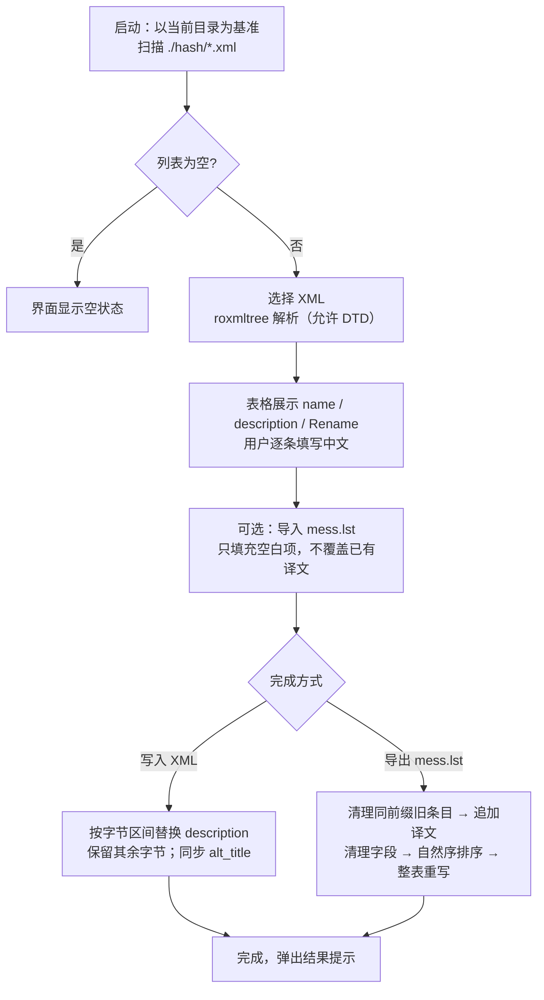

# MessGameList

## 一、项目概述

MessGameList 是一款基于 Rust / eframe 的桌面工具，用于批量为 MAME MESS 软件列表 XML 填写中文译名，并把结果写回原 XML 或汇总到 `mess.lst` 公共译名表，供其他 XML 导入复用。程序只从当前工作目录读写数据，因此 exe 需与 `hash\`、`mess.lst` 放在同一目录。


## 二、工作原理

**运行目录约定**

```
<运行目录>/
├── MessGameList.exe
├── hash/                 ← MAME 的 hash 目录，内含 *.xml 软件列表
│   ├── a2600.xml
│   └── ...
└── mess.lst              ← 可选；导入时不存在按 0 条处理，导出时自动创建
```

`hash\` 只在程序启动时扫描一次；运行期间新放入的 XML 需重启程序才会出现。仓库不附带 `hash\` 与 `mess.lst`，直接 `cargo run` 时若项目根目录没有 `hash\`，界面会显示空状态。


**主流程**



**XML 写回机制**

| 项目 | 行为 |
| --- | --- |
| 编码 | 必须 UTF-8（可带 BOM）；BOM 写回时保留 |
| 解析 | `roxmltree` 以 `allow_dtd` 打开 MAME 的 `<!DOCTYPE …>`；收集所有带 `name` 属性的 `<software>` |
| 定位 | 用节点的字节区间替换 `<description>` 整体文本，缩进、换行、注释、DTD、属性写法等其余字节原样保留 |
| 转义 | 译文中的 `& < > " '` 做 XML 转义 |
| alt_title | 译文以 `(日本)` 或 `（日本）` 结尾时，去掉结尾括号并更新同节点 `<info name="alt_title" value="…"/>` 的 `value`；没有该节点则不改动 |
| 跳过 | 无 `<description>` 子节点或译文为空的条目不计入写入数 |


**mess.lst 机制**

`mess.lst` 是 Tab 分隔的两列文本，第一列为键、第二列为译文：

```
a2600__adventp	冒险岛
a2600__pacman	吃豆人
```

- **键格式**：`XML文件名去扩展名__name`（双下划线），例如 `a2600.xml` 中 `name="adventp"` → `a2600__adventp`；导入时兼容旧版单下划线键。
- **导入**：读取 UTF-8（自动去 BOM），失败回退 GBK；跳过空行与无 Tab 的行，两列去除首尾空白；只填充 `Rename` 为空的条目。
- **导出**：删除第一列以 `文件名__` 开头的旧条目 → 追加当前 XML 已填译文 → 字段中的 Tab / 回车 / 换行折叠为空格 → 按第一列自然序排序 → 以 UTF-8（无 BOM）、CRLF 行尾整体重写。
- **自然序**：数字片段按数值比较（`s2` 排在 `s10` 前），其余忽略大小写；数值相同但写法不同（`s02` / `s2`）再按原串比较，保证排序稳定。


## 三、源码结构

```
MessGameList/
├── Cargo.toml       # 包信息与依赖声明
├── Cargo.lock       # 依赖版本锁定（已提交，保证各机构建一致）
├── src/
│   ├── main.rs      # GUI、交互、确认框与虚拟滚动表格
│   ├── lib.rs       # 库入口，仅导出 hanhua 模块
│   └── hanhua.rs    # 核心逻辑：XML 解析/写回、mess.lst 读写
├── LICENSE
└── README.md
```

| 文件 | 关键内容 |
| --- | --- |
| `main.rs` | `App` 负责目录扫描、XML 加载、置顶/还原、导入导出预览与确认；`eframe::App::ui` 绘制工具栏、表格和弹窗；包含 3 个按钮悬停回归测试 |
| `hanhua.rs` | `list_xml_files` / `parse_xml_file` / `write_translations` 处理 XML；`read_mess_list` / `write_mess_list` / `sort_mess_list` / `natural_cmp` / `make_key` 处理译名表；包含 8 个单元测试 |
| `lib.rs` | `pub mod hanhua;`，供 `main.rs` 以 `mess_gamelist::hanhua` 调用 |


## 四、依赖说明

| 类别 | 内容 |
| --- | --- |
| GUI | `eframe 0.36.2`（含 egui），负责窗口、事件循环与控件绘制；表格为手写虚拟滚动 |
| XML | `roxmltree 0.21.1`，解析 XML 并提供节点字节区间，支持 `allow_dtd` |
| 编码 | `encoding_rs 0.8.42`，用于 `mess.lst` 的 GBK 回退解码 |
| 其他声明 | `egui_extras 0.36.2`、`rfd 0.17.2` 在 `Cargo.toml` 中声明，当前源码未直接调用 |
| 标准库 | `std::fs` / `std::collections::HashMap` / `std::path` 等，无额外运行依赖 |
| 版本管理 | `Cargo.lock` 已提交；依赖缓存在全局 `~/.cargo/registry`，跨项目共享 |


## 五、项目构建

Rust 1.85+（edition 2024）；Windows / macOS / Linux 均可编译，发布目标为 Windows 10+ 可执行文件。

Windows 上 Rust 本身不含 C 代码，但生成 `.exe` 需要系统链接器；先用 `rustc -vV | Select-String host` 确认工具链：

| host | 链接器 | 需要安装 |
| --- | --- | --- |
| `x86_64-pc-windows-gnu` | `gcc.exe` → `ld.exe` | MinGW-w64 / MSYS2 |
| `x86_64-pc-windows-msvc` | `link.exe` | Visual Studio / Build Tools |

> 链接器路线由 Rust 工具链决定，与 PATH 中是否存在 `cl.exe` / `gcc.exe` 无关。GNU 路线需把 MinGW 的 `bin` 目录加入 PATH；MSVC 路线在 **Developer PowerShell for VS** 中编译即可。未配置 gcc PATH 时会报 `linker 'cc' not found`，此时指定链接器的优先级为：`RUSTFLAGS` > `CARGO_TARGET_<TRIPLE>_LINKER` > `.cargo/config.toml` > PATH 查找。`.cargo/config.toml` 含本机绝对路径，已在 `.gitignore` 中排除。

> GNU 工具链下即便 `gcc` 已在 PATH，运行 `cargo test` 链接测试程序时还需 MinGW 的 `binutils` / 导入库也在 PATH 上，否则会报 `cannot find -lshlwapi` 或 `dlltool.exe: program not found`。


**常用命令**

| 命令 | 说明 |
| --- | --- |
| `cargo build --release` | 构建发布版 |
| `cargo build` | 构建调试版 |
| `cargo run --release` | 构建并运行 |
| `cargo test` | 运行 8 个核心逻辑单元测试 + 3 个悬停回归测试 |
| `cargo clippy` | 静态检查 |
| `cargo build --release --offline` | 依赖已缓存时离线构建 |
| `cargo vendor` | 将依赖复制进 `vendor/`，用于离线 / 内网构建 |
| `cargo clean` | 清理 `target/` |


**产物位置**

- 发布版：`target/release/MessGameList.exe`（体积更小、运行更快，日常使用推荐）
- 调试版：`target/debug/MessGameList.exe`（带调试符号，用于排查问题）
- exe 需与 `hash\`、`mess.lst` 放在同一目录才能正常工作；把对应 exe 复制到 MAME 的 hash 所在目录即可使用，无需复制其他文件。
- `cargo run --release` 也会生成发布版 exe，但以项目根目录作为工作目录运行。
